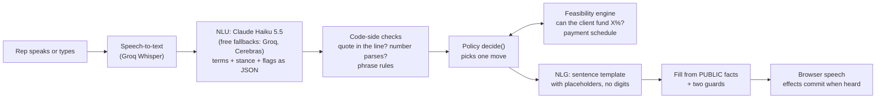

# Debt Settlement Agent

[](https://github.com/strike0702/Debt-Settlement-Agent/actions/workflows/ci.yml)

A voice and text agent that negotiates a debt settlement with a creditor's representative on behalf of a client. A language model reads what the representative says and puts the agent's replies into words. Ordinary Python code decides every offer, a separate settlement engine computes every number, and the model is never allowed to speak a digit or see the client's private finances. It is a personal project: all data is synthetic, and it is not a live collections product.

[](docs/assets/demo.mp4)

*A simulated "Haggling rep" call, slowed to 2.6 s per step. The rep asks for 70% and will not move. The agent offers 49%, holds once, steps up to 59%, makes a final offer of 62% when the rep says 65% is their lowest, and accepts 65% when the rep repeats it, because it is within the agent's limit. [MP4 version](docs/assets/demo.mp4).*

**Live demo:** [debt-settlement-agent-ggor.onrender.com](https://debt-settlement-agent-ggor.onrender.com/). Pick a scenario and press **Watch a call**: a simulated creditor plays the representative, so it needs no API keys. Press **Start call** to play the representative yourself (type, click a suggested reply, or use the mic). The demo runs on a free Render instance, so the first load after a quiet spell can take about 30 s.

The console has two views. The **Debt negotiator** view (called the operator view in the code) is the firm's side: the client's private finances, "How the agent decided" for every turn, the safety checks, latency, and the audit log. The **Creditor rep** view (`?view=rep`) shows only what the representative would see; the server filters every message sent to it, and a test scans whole calls for every private value. The operator view is public on the hosted demo by design, because every figure in it is synthetic.

## How it works

One representative turn, left to right. Language goes in and comes out through a model; decisions and arithmetic stay in Python.



The rules that hold on every turn:

- **The policy decides, not the model.** `decide()` picks the move (counter, confirm, ask about a creditor rule, refuse, hand off to a person) from the belief state, the checked reading of the line, and the engine's affordability curve.
- **Money is integer cents; percentages are integer basis points** (4500 = 45%). No floating point touches money.
- **The model never speaks a digit.** It writes templates like `We can offer {offer_pct}.`; code fills each placeholder from `Fact.render()`. `template_guard` rejects digits, `$`, `%` and number words in the template; `rendered_guard` rejects any figure in the final sentence that is neither a public fact nor a number the representative said, any private value, and premature commitment phrasing. A blocked line becomes a fixed safe sentence.
- **Private facts never reach the model.** The reply prompt sees PUBLIC facts only; the client's maximum, balances and fees stay in code.
- **The model's reading is untrusted input.** A quote that is not in the line is dropped, a hedged number stays tentative, and a short "yeah" only counts as acceptance when it is most of the line.
- **Everything is audited.** Belief changes, blocked sentences, hand-offs, each policy decision and every model call are written to an append-only SQLite log (triggers reject updates and deletes).

By default the demo's replies come from a bank of templates built and guard-checked offline (`NLG_MODE=bank`), so no model call sits on the reply path. The design decisions behind each rule, and one voice turn annotated stage by stage, are in [`docs/DESIGN.md`](docs/DESIGN.md).

## Where to start reading the code

| Start here | What it is |
|---|---|
| `app/agent/orchestrator.py` | Runs one turn end to end: NLU, belief update, affordability, policy, reply, and the spoken-sentence acknowledgement. |
| `app/agent/policy/` | `decide()` (`cascade.py`): the whole negotiation strategy as pure functions. Belief and verified NLU in, one `Action` out. The price ladder is in `ladder.py`. |
| `app/agent/nlu/` | Asks the model to read the line (`llm_call.py`), then `post_verify` (`verify.py`) checks quotes, numbers and phrase rules (`cues.py`) in code; amount questions are in `amounts.py`. |
| `app/agent/nlg.py`, `app/agent/guards.py` | Turns an `Action` into a template, fills it from facts, and runs the two guards. |
| `app/adapter/engine_adapter.py` | The only bridge to the engine: builds creditor rules from belief and scans 1%–100% for affordability. `app/adapter/validator.py` re-checks every drafted schedule independently. |
| `feasibility/engine.py` | `evaluate_offer`: the settlement math (brought in from an earlier project). |
| `app/llm/client.py` | Every model call goes through here by role (`nlu`, `nlg`, `sim`, `stt`), with fail-over and audit. Providers per role are in `config/providers.yaml`. |
| `app/voice/ws.py` | The WebSocket protocol for the console; `app/voice/views.py` filters what the creditor view may see. |
| `sim/creditor.py` | The simulated creditor representative used by "Watch a call" and the evals. It does not import the agent. |
| `eval/run_eval.py` | The eval runner; scoring is in `eval/metrics.py`. |
| `web/src/App.tsx` | The React console. |

## How negotiation decisions are made

The agent works for the client. It accepts only at or below 75% of the client's private maximum (the *accept line*), never offers more than that, and never says either number aloud. It always counters the representative's first number. If the representative comes down, the agent moves up by half as much; if they do not move, it holds once, then takes two equal steps to the lower of their number and the accept line. A "final" number above the line, a call that goes in circles, or any dead end (no affordable schedule, six counteroffers spent with the rep still above the line) hands the call to a person with a spoken reason and a logged reason code. A call ends only as a drafted deal marked `pending_client_approval` or as a hand-off. The full rules, settings and reason codes are in [ADR 7](docs/DESIGN.md#adr-7-how-negotiation-decisions-are-made).

## Results

Every number links to the committed file it comes from.

### Policy, offline (no keys, runs in CI)

Perfect understanding (an oracle stands in for the model), fixed reply templates, and the code-based creditor simulator across 100 seeded scenarios: flexible, contradictory, pressuring and haggling representatives, split into calls where a deal is possible, calls that need extra client funds, and calls with no possible deal. This isolates the negotiation logic from language errors.

```bash
python -m eval.run_eval --nlu oracle --nlg template --sim-phrasing template --scenarios 100 --seed 7
```

| What I measured | Result | n | 95% CI |
|---|---|---|---|
| [Valid agreements](docs/eval/policy_eval_20261009_50/summary.md) (independent validator) | 1.0 | 21 | 0.845–1.000 |
| [Deals when a deal is possible](docs/eval/policy_eval_20261009_50/summary.md) | 0.913 | 23 | 0.732–0.976 |
| [Correct hand-off to a person](docs/eval/policy_eval_20261009_50/summary.md) | 1.0 | 77 | 0.952–1.000 |
| [Rules wrongly marked as known](docs/eval/policy_eval_20261009_50/summary.md) | 0.000 | 463 | 0.000–0.008 |
| [Stuck calls (hit the turn limit)](docs/eval/policy_eval_20261009_50/summary.md) | 0.000 | 100 | 0.000–0.037 |
| [Private figures spoken](docs/eval/policy_eval_20261009_50/summary.md) (exact match; does not catch a paraphrase) | 0 | | |
| [Unverified figures spoken](docs/eval/policy_eval_20261009_50/summary.md) | 0 | | |

The two missed deals are simulated representatives who stall by design; the agent hands those to a person. Creditor rules learned is [0.661](docs/eval/policy_eval_20261009_50/summary.md) (n=700), because hand-offs end calls before the late read-back of rules. On deals the agent kept a mean of 0.873 of the available surplus between the creditor's walk-away point and the client's maximum.

### A/B: code policy against conversational replies and a ReAct agent

Four versions ran on the same 48 seeded scenarios with a live model reading every line and a live model phrasing the simulated creditor. I wrote the adoption rule down [before the run](docs/eval/ab_20261007/preregistration.md) and did not change it. Source: [`summary.md`](docs/eval/ab_20261007/summary.md), [`decision.md`](docs/eval/ab_20261007/decision.md).

| | A (shipped: code policy + templates) | B (same policy, conversational replies) | C (ReAct agent, sees the private maximum) |
|---|---|---|---|
| [Private figures spoken](docs/eval/ab_20261007/summary.md#results-common-scenarios-only) | 0 | 1 | 2 |
| [Unverified figures spoken](docs/eval/ab_20261007/summary.md#results-common-scenarios-only) | 0 | 0 | 8 |
| [Valid agreements](docs/eval/ab_20261007/summary.md#results-common-scenarios-only) | 0.75 (n=8) | 0.71 (n=7) | 0.73 (n=11) |
| [Correct hand-off to a person](docs/eval/ab_20261007/summary.md#results-common-scenarios-only) (n=27) | 1.00 | 1.00 | 0.22 |
| [Median server time per turn](docs/eval/ab_20261007/summary.md#results-common-scenarios-only) | 2.0 s | 1.8 s | 10.2 s |
| [Judged more natural than A](docs/eval/ab_20261007/summary.md#results-common-scenarios-only) (decisive pairs, 95% CI) | | 0.80 [0.61, 0.91] | 0.74 [0.58, 0.85] |
| [Passes the rule](docs/eval/ab_20261007/summary.md#pre-registered-adoption-rule-each-arm-vs-a) | baseline | no | no |

**A stays the default.** B read more naturally but spoke one private figure (the policy accepted a "100%" the simulated creditor invented, which was then fixed) and missed the agreement check. C failed on safety, hand-offs and speed. A fourth arm, a model with no policy, was stopped early and was behind A on every check it reached ([partial results](docs/eval/ab_20261007/partial_D/summary.md)). A's own 0.75 comes from live-model misreadings of creditor rules that every arm shares. A later live re-check of A with Claude Haiku reading the line had [10 of 10 valid agreements and 1.46 s median server time per turn](docs/eval/recheck_20261009/summary.md). I also rated 20 of the B-vs-A pairs blind myself and preferred B in 11 of 15 decisive pairs, against the model judge's 0.80 ([ratings](docs/eval/ab_20261007/summary.md#human-check-of-the-judge-added-in-phase-50)).

### Understanding messy lines (live, needs keys)

About 180 synthetic representative lines that I labelled by hand, scored after the code-side checks. All rows, per model and per prompt, are in [`docs/eval/nlu_corpus.md`](docs/eval/nlu_corpus.md); the raw per-line answers are in [`docs/eval/records/`](docs/eval/records/).

| What the model flags | Precision / recall after the code-side checks | Before them |
|---|---|---|
| [Asks for the client's private information](docs/eval/nlu_corpus.md#after) | 0.971 / 0.971 | [0.667 / 0.235](docs/eval/nlu_corpus.md#before) |
| [Demands a commitment](docs/eval/nlu_corpus.md#after) | 1.000 / 0.923 | [0.667 / 0.462](docs/eval/nlu_corpus.md#before) |
| [Accepts the offer](docs/eval/nlu_corpus.md#after) | 1.000 / 1.000 | [0.306 / 1.000](docs/eval/nlu_corpus.md#before) |

That table is the free-tier Groq model with the same prompt in both runs, so the gain is the repair code. The demo now reads the line with Claude Haiku 5.5: stance accuracy [0.869](docs/eval/nlu_corpus.md#haiku_p43_fix) on the corpus and [0.969](docs/eval/nlu_corpus.md#heldout_stance_haiku_p43_fix) on 32 held-out lines, at [1.17 s p50 per request](docs/eval/haiku_nlu_demo_20261008/summary.md) and about $0.0003 per line. The free fallbacks score [0.885 (Groq)](docs/eval/nlu_groq_20261009/summary.md) and [0.891 (Cerebras)](docs/eval/nlu_cerebras_20261009/summary.md) on the same prompt. I wrote both the lines and the rules, so the main corpus is not a blind test set; the held-out sets were written before the rules they test. The model comparison and its history are in [ADR 6](docs/DESIGN.md#adr-6-claude-reads-the-rep-on-the-demo-under-a-daily-cap).

### Latency

With the free Groq model reading the line, a typed turn took [1420 / 2242 ms p50 / p95](docs/eval/latency_20261007.md#after-key-pool-phase-27-2026-10-07) from message to first reply, almost all of it the model reading the line. From the end of speech to the first audio is about [4.7 s p50](docs/eval/latency_20261007.md#reading-it), but that is an **estimate** built from measured stages, not a browser measurement.

### What is not measured yet

- Voice end to end in a real browser.
- The hosted demo under load.
- A simulator, or test labels, written by someone other than me. The simulator and the agent share an author.
- A human check of the judge with more than one rater.

## Verify in 60 s

None of these need API keys.

```bash
uv sync --group dev
uv run pytest -q -m "not slow"     # what CI runs; drop -m to add the 100-seed invariant sweep
uv run python -m eval.run_eval --nlu oracle --nlg template --sim-phrasing template --scenarios 100 --seed 7
(cd web && npm ci && npm run build) && uv run uvicorn app.main:app --port 8000
# open http://127.0.0.1:8000, pick "Easy deal", press "Watch a call"
```

The eval prints a metrics table that should match [`summary.md`](docs/eval/policy_eval_20261009_50/summary.md) and exits with an error if any threshold is missed. CI runs `ruff check .` and the same tests on every push.

## Running locally

You need Python 3.12, [`uv`](https://docs.astral.sh/uv/), and Node 24 (or 22.22 or later) for the web console. The tests and the offline eval need no keys. The live demo needs at least one of `GROQ_API_KEY` or `GEMINI_API_KEY` in `.env`; server-side speech-to-text needs Groq. `ANTHROPIC_API_KEY` is optional and paid: with it, the `demo` profile reads the representative with Claude Haiku 5.5 and falls back to the free models when Claude is unavailable. Evals skip paid models unless you pass `--allow-budgeted` or an explicit `--providers` file.

```bash
uv sync --group dev
cp .env.example .env                  # fill in keys only for the live demo
(cd web && npm ci && npm run build)   # FastAPI serves web/dist at /
uv run uvicorn app.main:app --reload --host 127.0.0.1 --port 8000
```

`python -m app.cli fixtures/demo` runs a typed call from the terminal. `python -m eval.nlu_corpus --label AFTER` runs the live NLU corpus (needs keys). For UI work, see [`web/README.md`](web/README.md). Long live evals on free tiers can hit daily caps; [`docs/eval/README.md`](docs/eval/README.md#live-runs-and-free-tier-daily-limits) explains how to resume them.

## Project structure

```text
app/          Orchestrator, policy, NLU/NLG, guards, voice WebSocket
web/          React call console (Vite, TypeScript), served by FastAPI at /
feasibility/  Settlement math (from an earlier project of mine; part of this repo)
eval/         Eval runner, metrics, NLU corpus scorer, A/B arms and report
sim/          Creditor simulator (does not import the agent)
tests/        Unit, end-to-end, engine and NLU corpus tests
fixtures/     Synthetic clients, offers, demo scenarios
config/       Model routes per profile, NLG template bank
docs/         Design decisions, frozen eval evidence, build history
```

Python 3.12, FastAPI, Pydantic v2, SQLite, pytest and ruff; React with Vite and TypeScript; models from Anthropic, Groq, Cerebras, Gemini and others through one role-based client.

I built this with AI coding agents working from a written plan, phase by phase, and every phase had to pass the tests and the relevant evals before it was merged. The phase-by-phase development log is [`docs/history/PROGRESS.md`](docs/history/PROGRESS.md).

## What I would take from this

Keep financial rules in code you can test without a model, and treat a model's output like a submitted web form: parse it, check it, and drop whatever does not verify. Separate what the agent does from how it says it; once the two are mixed, you cannot tell a policy bug from a wording bug. Write the adoption rule down before you run a comparison: the conversational replies were judged more natural, and the rule still said no, for a real bug worth fixing first. And record every decision. If you cannot say afterwards why the agent offered 58%, you do not have a negotiation system.
